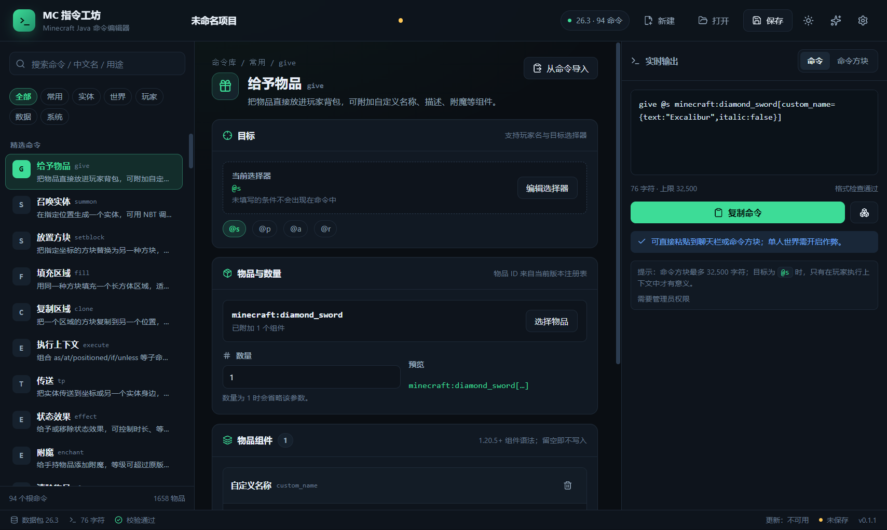

# MC 指令工坊

[](https://github.com/JiangNanChina/mc-command-studio/actions/workflows/ci.yml)
[](https://github.com/JiangNanChina/mc-command-studio/releases/latest)
[](LICENSE)

> Windows 桌面版 Minecraft Java 命令编辑器。用表单拼命令，实时复制，或生成放置命令方块的 `/setblock`。
>
> **不是网页**：安装包双击即用，不需要浏览器、服务器或账号，断网可编辑。
>
> **[下载最新版](https://github.com/JiangNanChina/mc-command-studio/releases/latest)**



## 功能（0.1.48）

- **品牌图标**：命令方块主题的应用图标、安装包图标与界面 Logo。
- **更新公告**：只展示当前版本更新，历史版本跳转 GitHub Releases；不再显示已知问题。
- **数据包工作区**：侧栏“工具”独立打开，多函数管理、load/tick 标签、文件预览与 zip 导出；与命令编辑彻底分开。
- **可视化选择**：物品、方块、状态效果、附魔、实体、声音统一为中文名 + 图标网格；支持中文名 / ID 搜索。
- **中文资源库**：26.3 官方中文名称（1,658 物品、1,286 方块、40 效果、43 附魔、161 实体、1,991 声音）+ 图标图集。
- **富文本可视化**：`tellraw` / `title` 支持多段文本、16 色、样式、点击/悬停、标题时序与实时预览。
- **声音可视化**：`playsound` / `stopsound` 支持 1,991 个声音、来源、坐标、音量/音调/最小音量。
- **BOSS 栏可视化**：`bossbar` 创建/更新/移除/查询/列表、颜色/样式/数值/可见性/玩家列表、实时预览。
- **计分板可视化**：`scoreboard` 目标创建/删除/显示位置/修改、玩家分数设置/加减/重置/查询/运算。
- **粒子可视化**：`particle` 128 种粒子、SNBT 参数（方块/红石尘/渐变/物品/颜色/原始）、位置/扩散/速度/数量/force/viewers。
- **世界控制**：`time` / `weather` / `difficulty` 合并页面，时间预设/自定义 tick、天气持续时间、难度说明。
- **标签与清除**：`tag` 添加/移除/查询实体标签；`clear` 清除全部或指定物品并可限制数量。
- **游戏规则**：`gamerule` 59 条规则，中文名/说明搜索、布尔开关/整数范围/查询。
- **世界边界**：`worldborder` 尺寸/扩展/中心/伤害/警告/查询，支持过渡时间与示意预览。
- **队伍**：`team` 创建/修改/加入/离开/删除/查询，16 色、友伤、隐身队友、名字标签与碰撞规则。
- **出生点与加载**：`spawnpoint` / `setworldspawn` 坐标与朝向；`forceload` 矩形区块加载。
- **实体属性**：`attribute` 总属性/基础值查询设置、修饰符增删、40 个中文属性名。
- **进度与自动化**：`advancement` 授予/收回、`function` 宏参数、`schedule` 延迟/清除。
- **物品槽位**：`item` 实体/方块容器替换、1–99 数量、物品修饰符。
- **高级数据包**：谓词、进度、战利品表 JSON 模板与校验；三者均支持常用结构可视化。
- **NBT 与战利品**：`data` 查询/修改/合并/删除（含 from 来源），`loot` 给予/生成/插入。
- **队伍文本**：`team` 前缀/后缀与高级显示名可视化文本组件。
- **单元体系**：资源 ID、数值、物品栈、槽位统一校验。
- **一键模板库**：8 个模板；支持切换目标版本（含 1.20.4 NBT 剑）。
- **多版本**：26.3 主版本 + 1.21.1 组件版 + 1.20.4 命令树版，可在顶栏切换。
- **26.3 数据包**：94 个根命令、1,197 个字面量、59 种参数类型。
- **1.21.1 数据包**：83 个根命令、1,333 物品、1,060 方块。
- **1.20.4 数据包**：82 个根命令，NBT 引擎；NBT give/item、loot、32 个兼容表单与召唤预设。
- **专用表单**：`give`、`summon`、`setblock`、`execute`、`tp`、`effect`、`fill`、`clone`、`enchant`、`xp`、`tellraw`、`title`、`playsound`、`stopsound`、`bossbar`、`scoreboard`、`particle`、`time`、`weather`、`difficulty`、`tag`、`clear`、`gamerule`、`worldborder`、`team`、`spawnpoint`、`setworldspawn`、`forceload`、`attribute`、`advancement`、`function`、`schedule`、`item`、`data`、`loot`、`gamemode`、`damage`、`rotate`。
- **命令方块链**：按方向排布最多 64 个脉冲/连锁/循环方块，自动偏移坐标，生成整链 `/setblock`。
- **execute 执行链**：as/at/positioned/align/anchored/facing/rotated/in/if/unless/store/raw 可排序积木 + run。
- **状态效果**：可视化选择效果，支持自定义秒数或永久（infinite）、等级、隐藏粒子。
- **撤销 / 重做**：覆盖所有表单、通用构建器、项目名称、命令方块设置和数据包草稿；Ctrl+Z / Ctrl+Shift+Z / Ctrl+Y，最多 100 步。
- **give**：目标选择器、物品搜索、数量、13 类物品组件；文本导入。
- **setblock**：方块选择、方块状态属性、方块实体 NBT、4 种放置模式。
- **更新公告**：每个版本的新增 / 改进 / 修复 / 已知问题内置在应用中；更新后首次启动显示横幅，顶栏铃铛随时查看版本历史。
- **通用构建器**：未覆盖命令仍保留官方命令树作为高级兜底。
- **本地项目**：`.mcstudio` JSON、最近打开、4 秒防抖自动保存、异常退出恢复。
- **桌面体验**：深色/浅色主题、中文界面、原生菜单、文件关联、单实例、高 DPI。
- **分发与更新**：NSIS 安装包 + 便携版 + `latest.yml`；electron-updater 自动检查/下载/重启安装；GitHub Actions 发布流水线。已在本机验证 0.1.47 → 0.1.48 静默升级；便携版会禁用自动更新并提示手动下载。

## 下载与安装

发布页：https://github.com/JiangNanChina/mc-command-studio/releases

- 安装版：`MC-Command-Studio-Setup-<版本>.exe`，单用户安装，无需管理员。
- 便携版：`MC-Command-Studio-<版本>-portable.exe`，双击即用；**便携版不会自动更新**，请手动下载新版。
- 校验和：发布页附 `checksums.txt`（本地构建产物在 `release/checksums.txt`）。

> 当前构建未做代码签名，Windows SmartScreen 可能提示“未知发布者”。选择“更多信息 → 仍要运行”，或自行校验 SHA-256。正式发布前应配置证书，见 [docs/08-release-update.md](docs/08-release-update.md)。

系统要求：Windows 10 22H2+ / Windows 11 x64。

## 从源码构建

需要 Node.js 24+、pnpm 11+。

```bash
pnpm install
pnpm setup:electron     # Electron 45 不再自动下载运行时
pnpm data:build         # 生成 packs/26.3（约 2.2 MB）
pnpm dev                # 开发模式
pnpm typecheck
pnpm test
pnpm build:win          # 安装包 + 便携版 + latest.yml
```

产物在 `release/`：

- `MC-Command-Studio-Setup-0.1.48.exe`
- `MC-Command-Studio-0.1.48-portable.exe`
- `latest.yml`、`.blockmap`

如果 `pnpm install` 后没有 Electron 二进制，运行 `pnpm setup:electron`；国内网络可设置：

```powershell
$env:ELECTRON_MIRROR = "https://npmmirror.com/mirrors/electron/"
$env:ELECTRON_BUILDER_BINARIES_MIRROR = "https://npmmirror.com/mirrors/electron-builder-binaries/"
```

## 数据来源

命令树、注册表、方块状态、物品组件默认值来自 Minecraft 官方数据生成器（`server.jar --reports`），通过 [misode/mcmeta](https://github.com/misode/mcmeta) 的 summary tag 获取并校验。数据包不包含游戏 jar、材质或语言文件。

重新生成 / 校验：

```bash
pnpm data:build --force
pnpm data:verify
```

## 测试

```bash
pnpm test        # 232 个核心逻辑用例
pnpm e2e         # Playwright 启动 Electron，覆盖 give/导入/summon/setblock/命令方块
```

`pnpm e2e` 需要先 `pnpm build`，并且需要可用的 Windows 桌面会话。截图输出到 `artifacts/`。

## 发布与自动更新

- 仓库已配置为 `JiangNanChina/mc-command-studio`。如果你 fork 到其他账号，运行下面的命令重新配置：

```bash
pnpm configure:github <你的GitHub用户名> mc-command-studio
```
- 更新版本并打 tag：

```bash
pnpm release:patch
git add . && git commit -m "release: v0.1.1"
git tag v0.1.1
git push origin main --tags
```

- GitHub Actions `Release` 会构建并创建 draft Release，上传安装包、便携版、`latest.yml`、blockmap、checksums。
- 人工检查 draft 后发布，客户端即可自动更新。
- 便携版通过 `PORTABLE_EXECUTABLE_DIR` 识别，不会请求更新源，只提示手动下载。
- 国内可配置 `generic` 镜像（`MCSTUDIO_UPDATE_URL`），详见 [docs/08-release-update.md](docs/08-release-update.md)。

## 目录

```
apps/desktop/        Electron 主进程 / preload / React 界面
packages/core/       命令序列化、校验、数据包 schema（纯 TS）
packages/content/    命令中文名、分类、示例、组件元数据
tools/pipeline/      数据包构建/校验
tools/release/       版本、Electron 安装、本地更新源
docs/                产品、架构、数据、命令模型、UI、版本、路线、发布
packs/               生成的数据包（不入库）
release/             打包产物（不入库）
```

## 已知限制

- 当前只实现 26.3 的现代语法；1.13–1.20.4 与 1.12.2 在路线图中。
- 复杂物品组件暂以原始 SNBT 输入，后续补专用表单。
- 不连接游戏做语义验证；语法/格式能校验，实际效果需进游戏确认。
- 便携版不支持自动更新。

## 许可与声明

- 代码：MIT（见 [LICENSE](LICENSE)）。
- 命令中文说明、界面文案：原创。
- 非官方产品：与 Mojang Studios、Microsoft 没有关联，也未获得其批准或认可。Minecraft 是 Mojang Studios 的商标。
- 第三方依赖许可见 [THIRD_PARTY_NOTICES.md](THIRD_PARTY_NOTICES.md)。

## 文档

- [产品定义](docs/01-product.md)
- [架构](docs/02-architecture.md)
- [版本数据包](docs/03-version-data.md)
- [命令模型](docs/04-command-model.md)
- [界面与交互](docs/05-ui-ux.md)
- [全版本路线](docs/06-version-matrix.md)
- [路线图与风险](docs/07-roadmap-risks.md)
- [发布与自动更新](docs/08-release-update.md)
- [中文名称与图标资源](docs/09-visual-assets.md)
