# 05 · 界面与交互

## 1. 主界面

三栏布局：

- **左栏**：命令库。搜索、分类（全部/常用/实体/世界/玩家/数据/系统）、精选命令（中文名+说明）、其他命令（仅命令 ID）。
- **中栏**：当前工作区。欢迎页、`give` 专用表单或通用构建器。
- **右栏**：实时输出与命令方块参数。
- **底栏**：数据包版本、字符数、校验结果、自动保存时间、更新状态、保存状态、程序版本。

顶部有项目名（可直接改）、未保存圆点、数据包胶囊、新建/打开/保存、主题、检查更新、设置。

## 2. 欢迎页

- 一句价值主张 + 当前数据包版本。
- 6 个快捷命令卡片：`give`、`summon`、`setblock`、`execute`、`effect`、`tellraw`。
- 三步说明。
- 最近打开项目（最多 5 条）。
- 自动保存恢复横幅（若是上次异常退出）。

## 2.1 可视化资源选择器

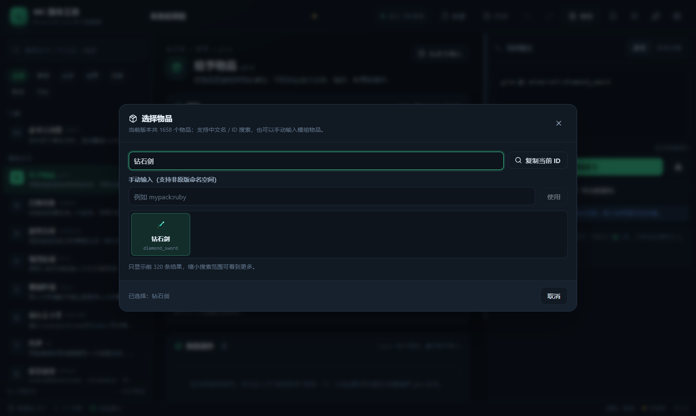

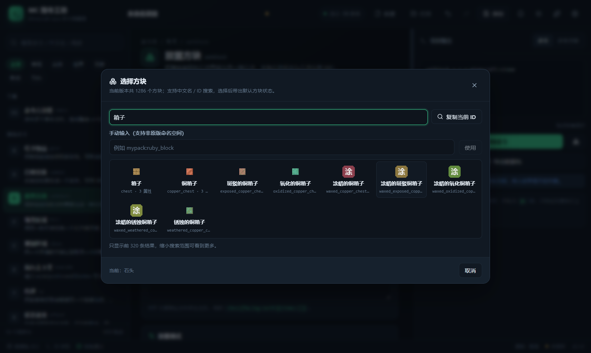

- 物品 1,658、方块 1,286、状态效果 40、附魔 43、实体 161。
- 每项显示中文名 + 图标 + ID；搜索同时匹配中文名和 ID。
- 物品/方块优先使用 26.3 客户端真实材质；缺失项及效果/附魔/实体使用中文首字彩色图标。
- 网格选择器支持手动输入非原版 ID；选择后已选卡片立即显示中文名与图标。
- 选择器数据来自内置图集，不依赖联网。

## 3. give 表单

| 区块 | 交互 |
|---|---|
| 目标 | 当前选择器预览；`@s/@p/@a/@r` 快捷切换；“编辑选择器”打开弹窗 |
| 物品与数量 | 物品选择弹窗（中文名 / ID 搜索、图标、手动输入）、数量输入、物品预览 |
| 物品组件 | 13 类组件卡片；“添加组件”下拉；每张卡片可删除 |
| 文本导入 | 页头“从命令导入”打开弹窗，粘贴 `/give` 后解析、应用 |
| 输出 | 右侧实时更新；字符数；校验提示；“复制命令” |

组件编辑器：

- 自定义名称 / 默认名称：文本、颜色下拉、斜体复选框。
- 描述：多行，每行独立颜色/斜体/删除，可加行。
- 附魔：ID 可搜索（datalist），等级 1–255，可增删。
- 无法破坏：说明性卡片，无输入。
- 最大堆叠 / 最大耐久 / 已消耗耐久 / 稀有度 / 附魔光效 / 自定义数据 / 自定义模型数据：对应数字、下拉、开关或 SNBT 文本域。
- raw：直接填写组件 ID 与 SNBT，用于尚未收录的组件。

## 3.1 summon 专用表单

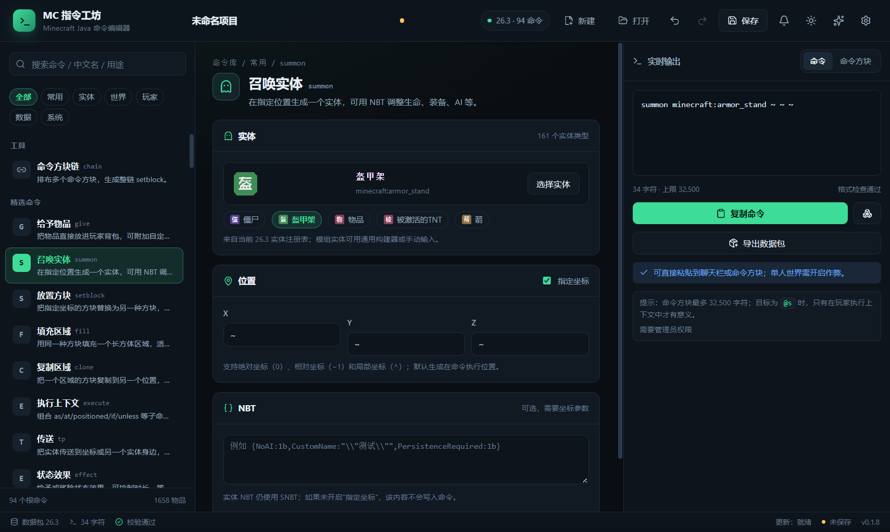

- 实体 ID 输入 + 161 项 datalist + 5 个快捷实体。
- “指定坐标”开关；X/Y/Z 支持 `~` / `^`。
- 可选实体 NBT；未开启坐标时 NBT 被忽略并给出提示。
- 输出示例：`summon minecraft:armor_stand ~ ~ ~`。

## 3.2 setblock 专用表单

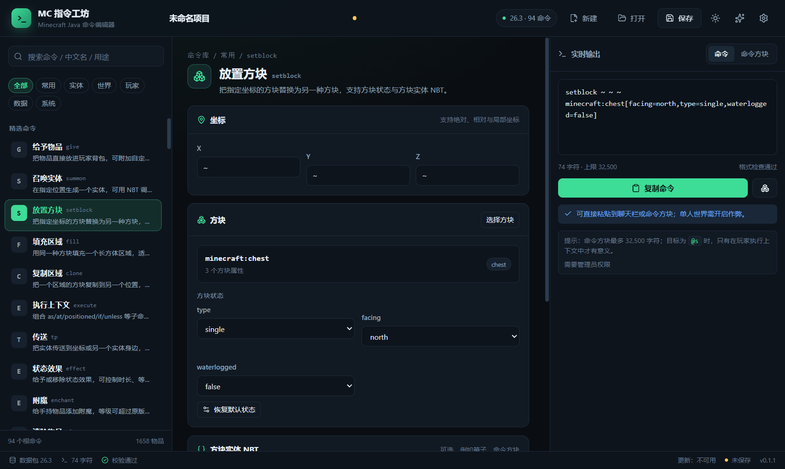

- 坐标三连框。
- 方块选择弹窗（1,286 个方块，搜索 + 手动输入）。
- 自动带出 `blocks.json` 的默认方块状态；每个属性一个下拉，可恢复默认。
- 方块实体 NBT 文本域，提示 NBT 紧贴方块状态。
- 放置模式：replace（省略）、destroy、keep、strict。

## 3.3 execute 执行链

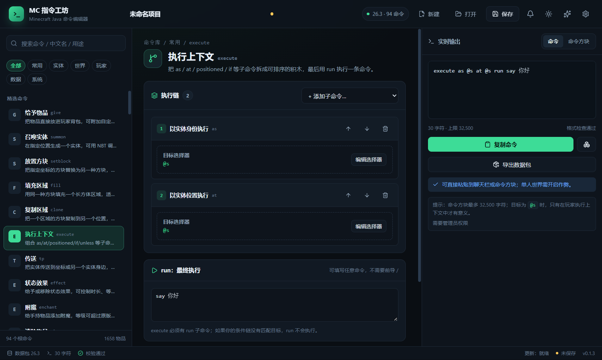

- 顶部“添加子命令”下拉：as / at / positioned / align / anchored / facing / rotated / in / if / unless / store / 原始子命令。
- 每个子命令是一张可排序卡片：编号、类型、上移/下移/删除；as/at 与 if entity 可直接打开选择器弹窗。
- positioned/facing 为三坐标；rotated 为偏航/俯仰；in 提供维度补全；align/anchored 用下拉。
- if/unless 支持实体、方块、计分板比较、原始条件；store 支持 result/success + score 目标。
- 底部 `run` 文本域填写最终命令，输出实时拼接为 `execute <clauses> run <command>`。
- 模板按钮：“以执行者身份运行”“条件判断”“坐标 + 朝向”。

## 3.4 数据包工作区

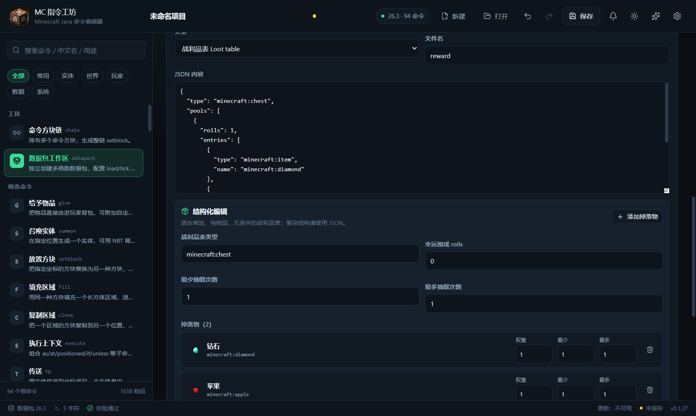

- 侧栏“工具 → 数据包工作区”单独打开，与命令编辑彻底分开。
- 数据包信息：命名空间、描述、当前 `pack_format`。
- 多函数管理：新建、切换、重命名、删除，最多 64 个；函数名支持 `lib/init` 子目录。
- 每个函数独立命令文本域，每行一条命令，前导 `/` 可省略。
- load / tick 标签通过下拉选择函数，不设置则省略对应 tag。
- 导出前预览完整文件树；命名空间/函数名/重复函数名/标签目标在导出前校验。
- **高级数据文件**：添加谓词、进度、战利品表 JSON，带模板、路径预览与 JSON 校验。
- **战利品表结构化编辑**：类型、rolls、幸运加成、掉落物权重与数量区间；复杂结构自动回退 JSON。
- 独立导出 `.zip`，可直接放进世界 `datapacks/`。
- 命令编辑器的输出面板不再提供数据包导出按钮。

## 3.5 tp 传送表单

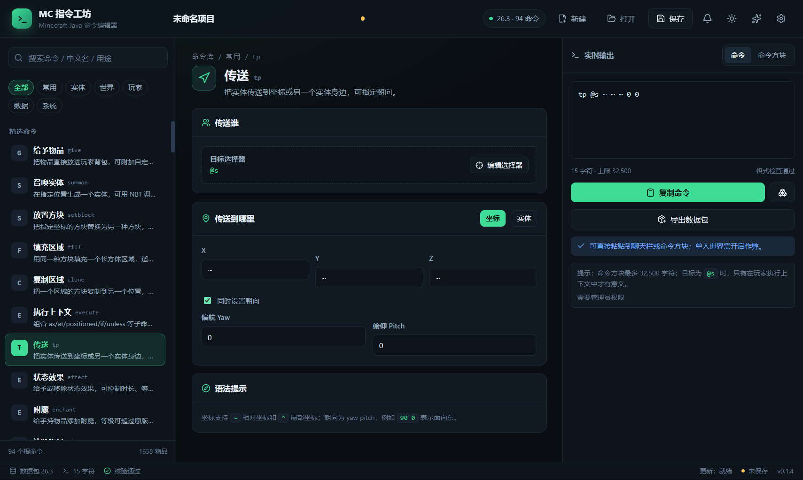

- “传送谁”选择器；支持玩家、实体、标签等。
- 目的地切换：坐标 / 实体。坐标模式为 X/Y/Z 三连框；实体模式复用选择器。
- “同时设置朝向”勾选后出现偏航/俯仰输入，生成 `tp @s ~ ~ ~ 90 0`。
- 实体目的地不支持朝向，界面会提示。

## 3.6 effect 状态效果

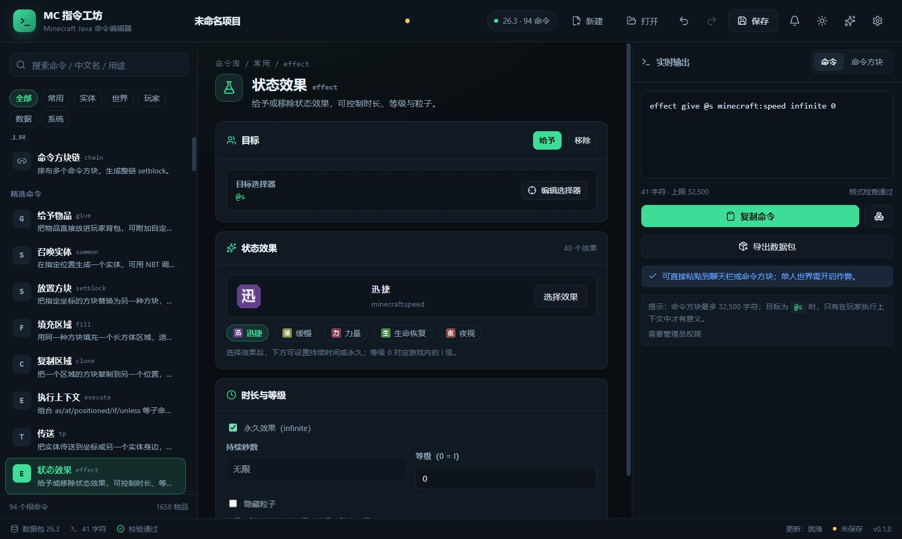

- 给予 / 移除模式切换。
- 40 个状态效果补全 + 快捷效果（speed/slowness/strength/regeneration/night_vision）。
- 状态效果改为图标网格选择器（中文名 + 图标）。
- 给予模式可填持续秒数，或勾选“永久（infinite）”；等级（0 = I）、隐藏粒子。
- 移除模式可留空效果 ID 以清除全部效果。

## 3.7 fill 填充区域

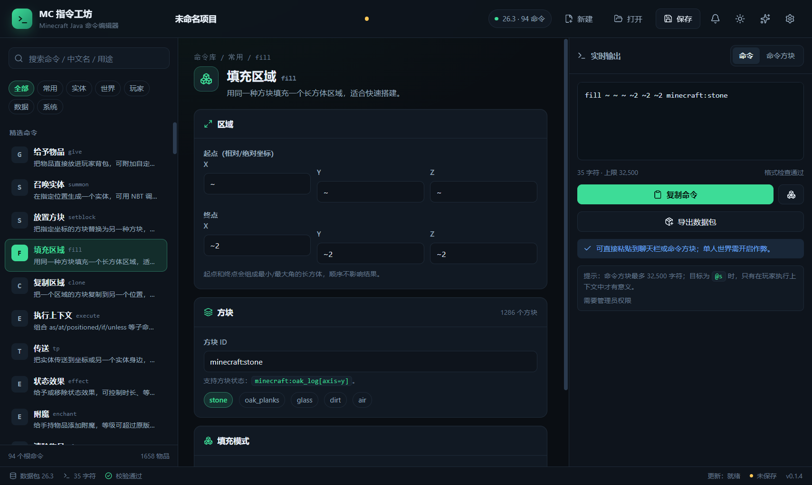

- 起点/终点各三个坐标框，支持相对坐标。
- 方块 ID 补全（1,286 个）+ 快捷方块；支持方块状态。
- 模式：replace/destroy/hollow/keep/outline/strict。
- replace 模式可填过滤方块；其他模式会忽略并提示。

## 3.8 clone 复制区域

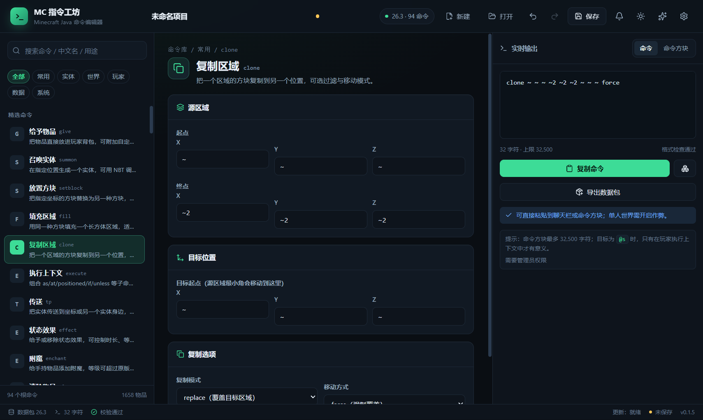

- 源区域起点/终点、目标起点各三坐标框。
- 复制模式：replace（覆盖）、masked（只复制非空气）、filtered（只复制指定方块）。
- 移动方式：normal（保留源）、force（强制覆盖）、move（复制后清空源）。
- filtered 模式显示过滤方块输入与 1,286 个方块补全。

## 3.9 命令方块链

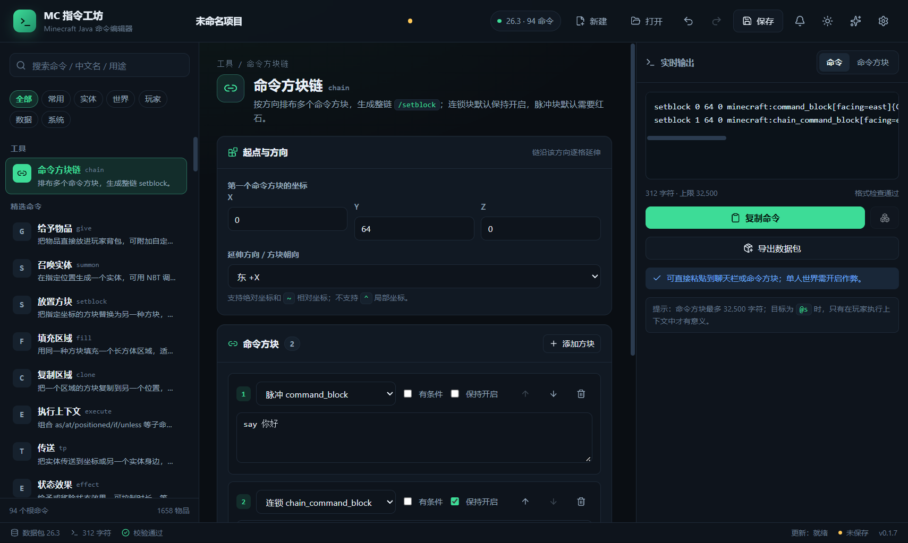

- 侧栏“工具 → 命令方块链”进入；不是根命令，不依赖命令树。
- 起点坐标 + 延伸方向（东/西/南/北/上/下），自动逐格偏移。
- 每个方块可设：脉冲/连锁/循环、有条件、保持开启、命令文本。
- 支持上移/下移/删除，最多 64 个方块。
- 整链预览 + “复制全部”；输出面板同步显示多行 `/setblock`。
- 链模式下禁用“命令方块”输出切换。

## 3.10 enchant 附魔

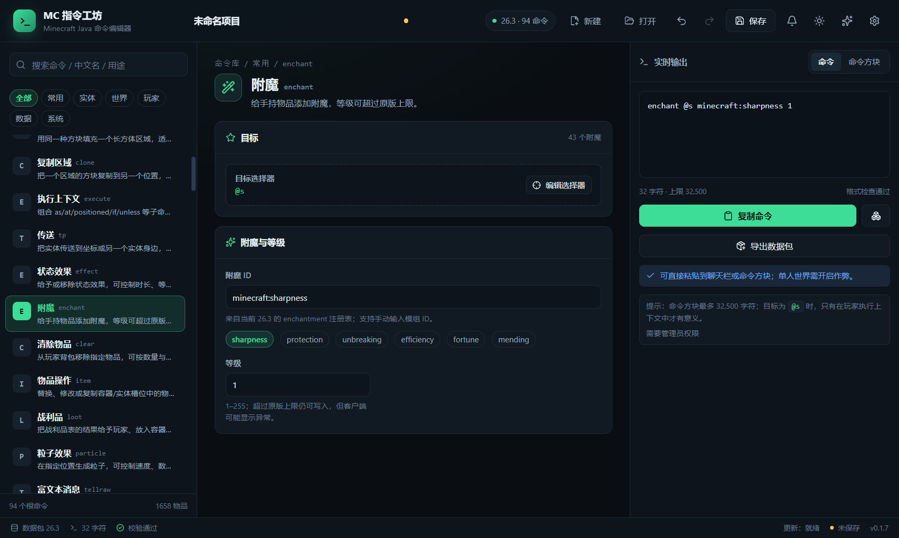

- 目标选择器；43 个附魔补全 + 6 个快捷附魔。
- 等级 1–255，超过原版上限仍可写入。
- 作用于目标主手物品。

## 3.11 xp 经验

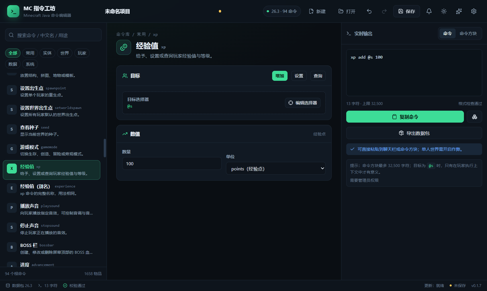

- 增加 / 设置 / 查询三种模式。
- 目标选择器；数量 + points/levels。
- 查询模式隐藏数量，只保留查询单位。

## 3.12 tellraw 富文本

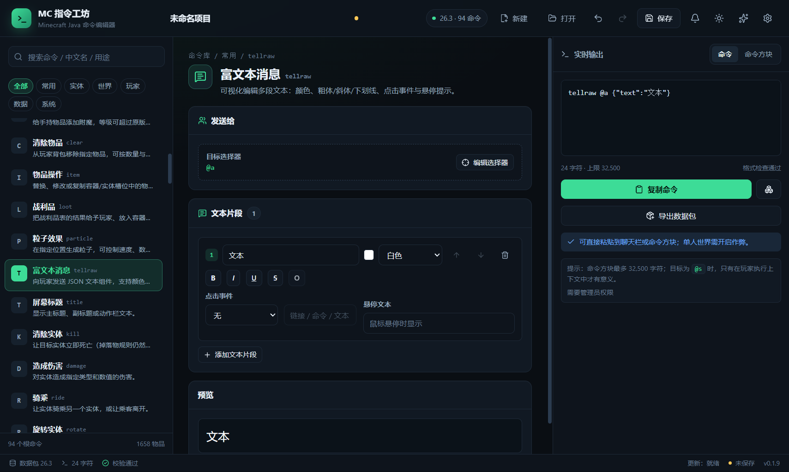

- 目标选择器 + 多段文本。
- 每段支持 16 色、粗体/斜体/下划线/删除线/随机字符。
- 点击事件：打开链接 / 执行命令 / 填入命令 / 复制到剪贴板。
- 悬停文本；实时预览与游戏内样式一致。

## 3.13 title 标题

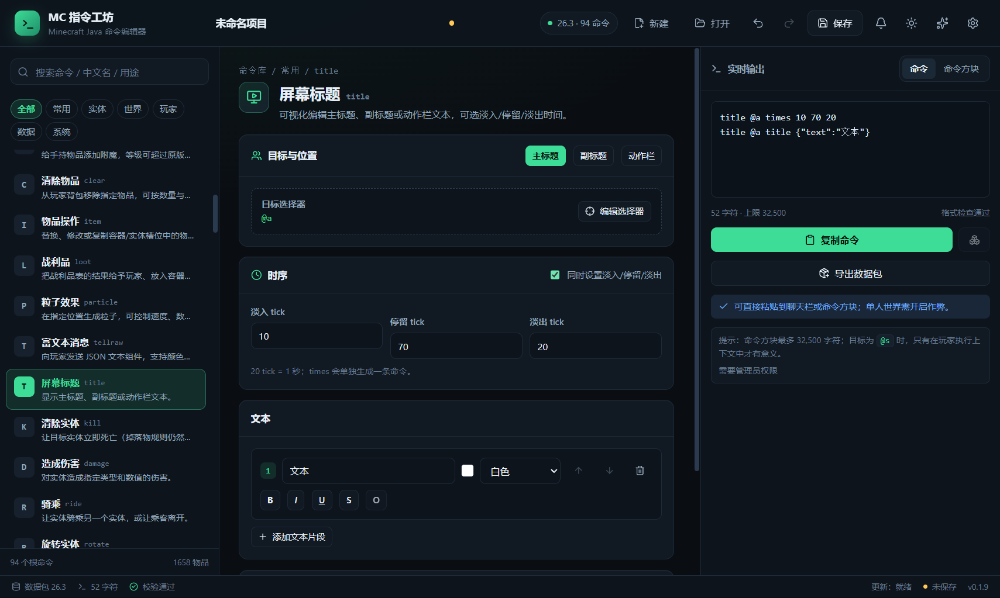

- 主标题 / 副标题 / 动作栏切换。
- 可选淡入/停留/淡出 tick；20 tick = 1 秒。
- 文本样式与 tellraw 共用编辑器。
- 同时设置时序时输出两行命令，自动禁用单命令方块模式。

## 3.14 playsound / stopsound

- 播放/停止模式切换；1,991 个声音的中文名/ID 搜索。
- 播放：来源、目标、坐标、音量、音调、最小音量。
- 停止：全部声音 / 指定来源 / 指定声音。
- 声音使用中文字幕名与首字图标；部分无字幕声音回退英文 ID。

## 3.15 bossbar BOSS 栏

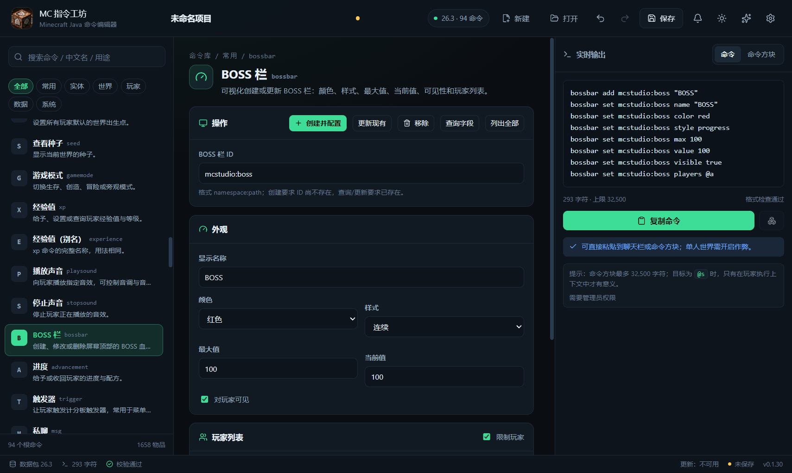

- 创建并配置 / 更新现有 / 移除三种操作。
- 7 种颜色、5 种样式（连续 / 6 / 10 / 12 / 20 段）。
- 最大值、当前值、可见性、玩家列表开关 + 选择器。
- 可视化预览：颜色、填充比例、分段刻度。
- 创建时自动生成 add + 7 条 set 命令；多行输出禁用单命令方块模式。

## 3.16 scoreboard 计分板

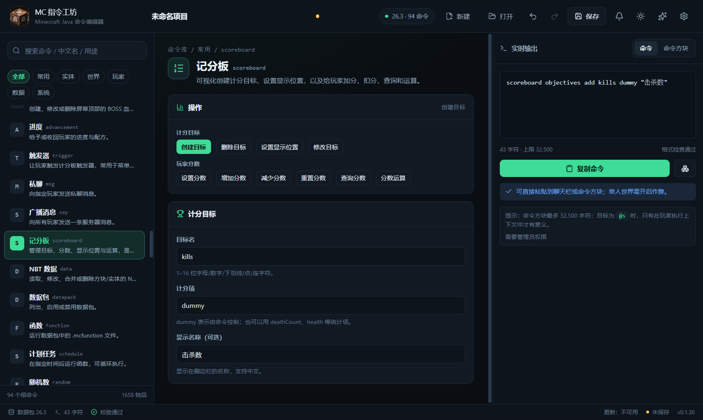

- 操作分两组：计分目标（创建/删除/显示位置）、玩家分数（设置/增加/减少/重置/查询/运算）。
- 计分项建议：dummy、trigger、deathCount、playerKillCount、health 等，也支持自定义。
- 显示位置建议：sidebar、list、belowName；队伍位置可直接输入。
- 运算支持 `= += -= *= /= %= < > ><`。
- 侧边栏预览：目标名、玩家、分数或运算表达式。

## 3.17 particle 粒子效果

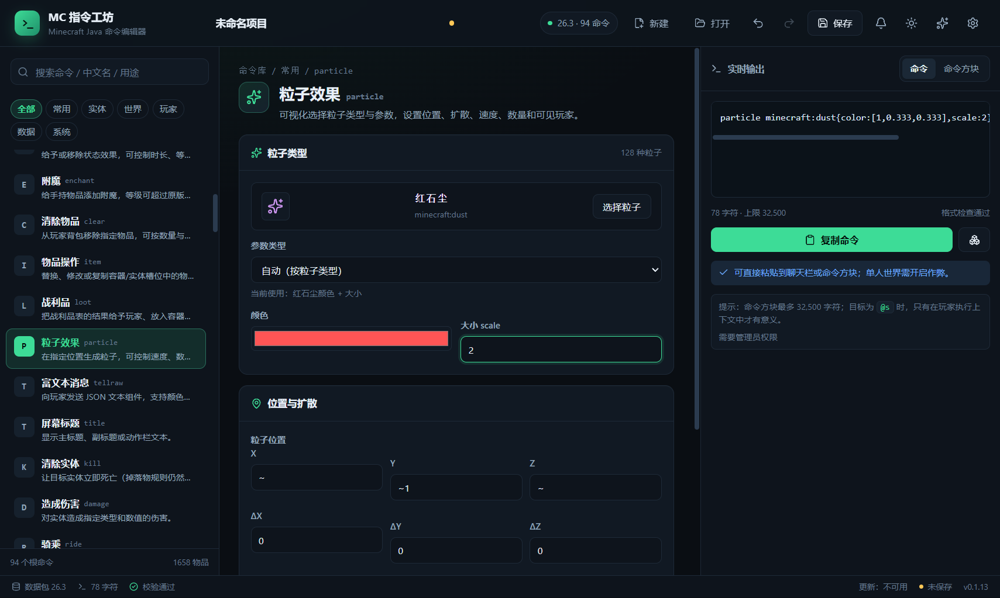

- 128 种粒子，中文名 / ID 搜索；粒子选择器统一使用粒子图标。
- 参数类型可自动推断，也可手动切换：方块 / 红石尘 / 渐变 / 物品 / 药水颜色 / RGBA / 原始 SNBT。
- 26.3 使用 SNBT 参数，例如 `minecraft:dust{color:[1,0.333,0.333],scale:2}`。
- 方块/物品参数复用中文图标选择器。
- 位置、ΔX/ΔY/ΔZ、speed、count、force、viewers 全部可视化。

## 3.18 世界控制 time / weather / difficulty

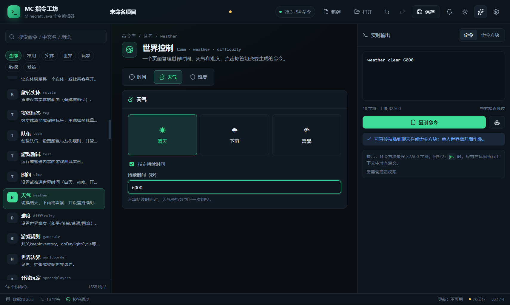

- 时间 / 天气 / 难度三个标签共用页面。
- 时间：设置 / 推进 / 查询；白天、正午、夜晚、午夜、日出、日落、自定义 tick。
- 天气：晴天 / 下雨 / 雷暴 + 可选持续时间（秒）。
- 难度：和平 / 简单 / 普通 / 困难，带机制说明。
- 点击标签会切换侧栏当前命令，输出与命令方块模式联动。

## 3.19 tag 实体标签

- 添加 / 移除 / 查询三种操作。
- 实体目标选择器；添加/移除时填写标签名。
- 标签名禁止空格，建议使用 `map.wave1` 这类命名空间风格。

## 3.20 clear 清除物品

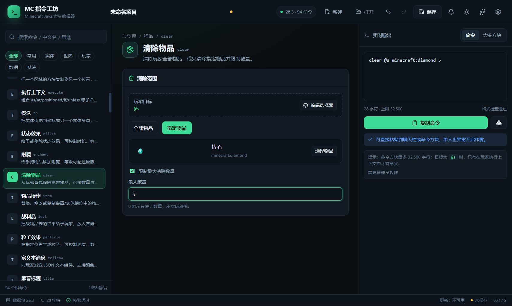

- 清除全部物品或指定物品。
- 指定物品复用中文图标选择器。
- 可选最大数量；0 表示只统计数量、不实际移除。
- 全部物品模式下不显示数量上限（命令语法不支持）。

## 3.21 gamerule 游戏规则

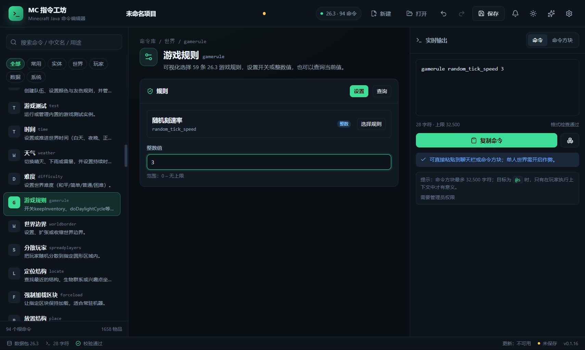

- 59 条 26.3 规则，支持中文名 / ID / 说明搜索。
- 规则卡片显示布尔/整数类型徽标。
- 布尔规则用开启/关闭按钮；整数规则输入并显示范围。
- 支持查询当前值，不修改世界。

## 3.22 worldborder 世界边界

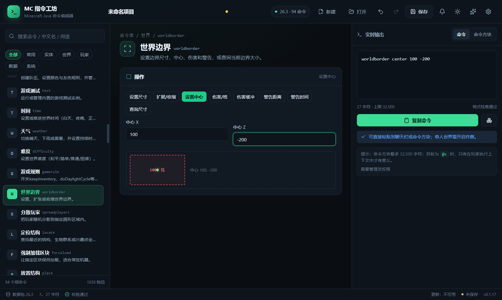

- 8 种操作：设置尺寸、扩展/收缩、设置中心、伤害/格、伤害缓冲、警告距离、警告时间、查询。
- 尺寸可指定过渡时间（`10`/`10s`/`10t`/`10d`）。
- 中心 X/Z、伤害、警告字段随操作切换。
- 边界示意预览 + 中心坐标提示。

## 3.23 team 队伍

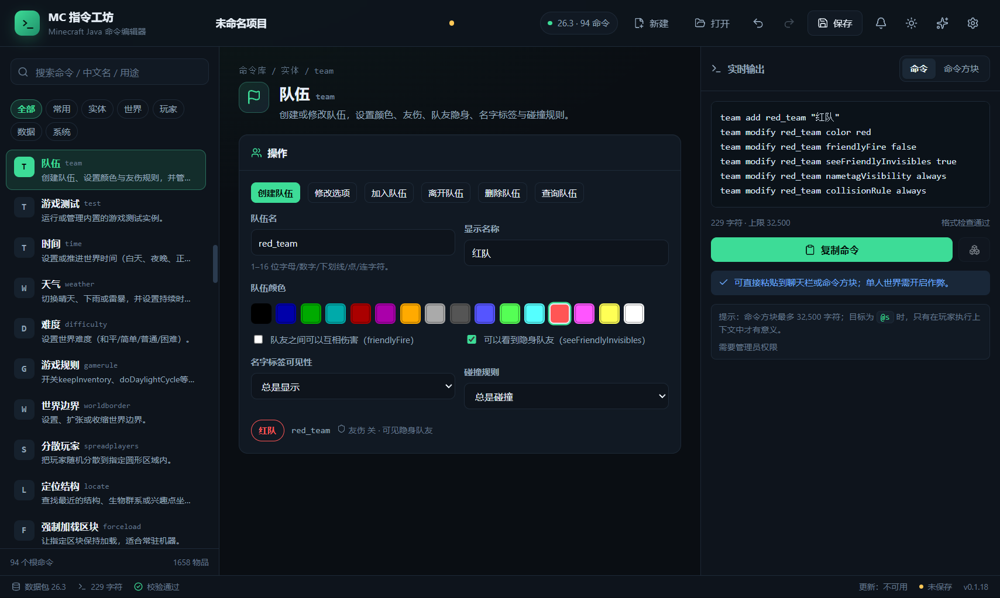

- 创建/修改/加入/离开/删除/查询六种操作。
- 队伍名、显示名称、16 色色板。
- 友伤、队友隐身开关。
- 名字标签可见性、碰撞规则下拉。
- 创建生成 add + 5 条 modify，多行输出禁用单命令方块。

## 3.24 spawnpoint / setworldspawn / forceload

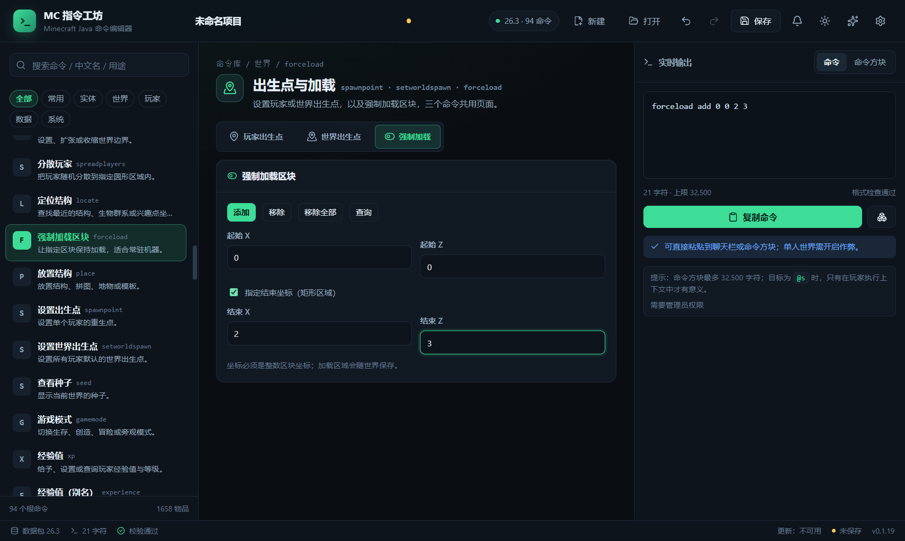

- 三个标签：玩家出生点、世界出生点、强制加载。
- 玩家出生点：目标选择器、坐标、可选 yaw/pitch。
- 世界出生点：坐标、可选朝向。
- 强制加载：添加/移除/移除全部/查询；支持单区块或矩形区域。
- 区块坐标整数校验，加载区域随世界保存。

## 3.25 attribute 实体属性

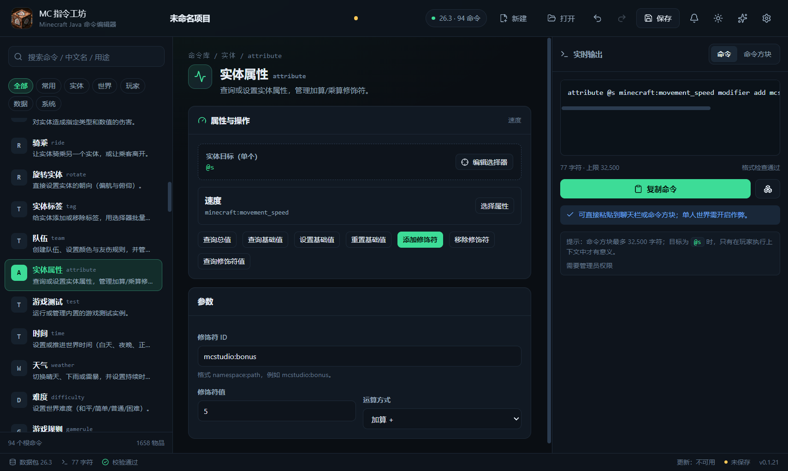

- 单实体目标 + 40 个带中文名的属性选择器。
- 查询总值 / 查询基础值 / 设置基础值 / 重置基础值。
- 修饰符添加、移除、查询值；支持加算、基础值乘算、总值乘算。
- scale 缩放查询结果。

## 3.26 advancement / function / schedule

- advancement：授予/收回、only/from/through/until/everything、条件名。
- function：函数名、可选 SNBT 宏参数，数据包函数自动补全。
- schedule：延迟运行、append/replace、清除计划。
- 三个命令分别有独立表单，侧栏可直接打开。

## 3.27 item 物品槽位

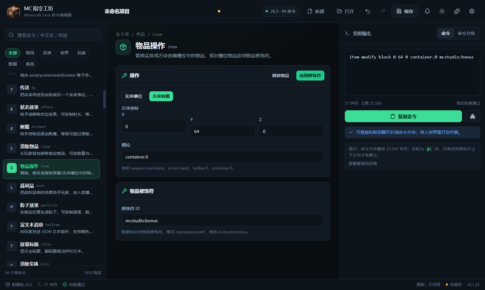

- 实体/方块容器两种目标。
- 槽位输入与建议：weapon.mainhand、armor.head、hotbar.0、container.0 等。
- 替换物品：中文物品选择器 + 1–99 数量。
- 应用修饰符：物品修饰符 ID。

## 3.28 单元体系

- 共享 `units.ts`：资源 ID、数值、物品栈、槽位。
- 新增命令优先复用单元校验，错误码稳定，便于 UI 定位字段。
- 详细说明见 [单元体系](10-unit-system.md)。

## 3.29 data / loot

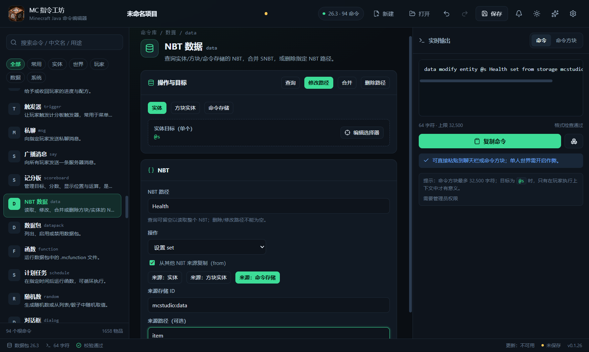

- data：实体/方块实体/命令存储，查询、修改（set/merge/append/prepend/insert/remove，支持 from 来源）、合并 SNBT、删除路径；查询支持 scale。
- loot：给予玩家、生成掉落物、插入容器；战利品表支持数据包 loot_table 建议。
- team：名字前缀/后缀/高级显示名使用文本片段编辑，支持颜色/加粗等样式与预览。
- 两个表单分别从侧栏“NBT 数据”“战利品”打开。

## 4. 通用构建器

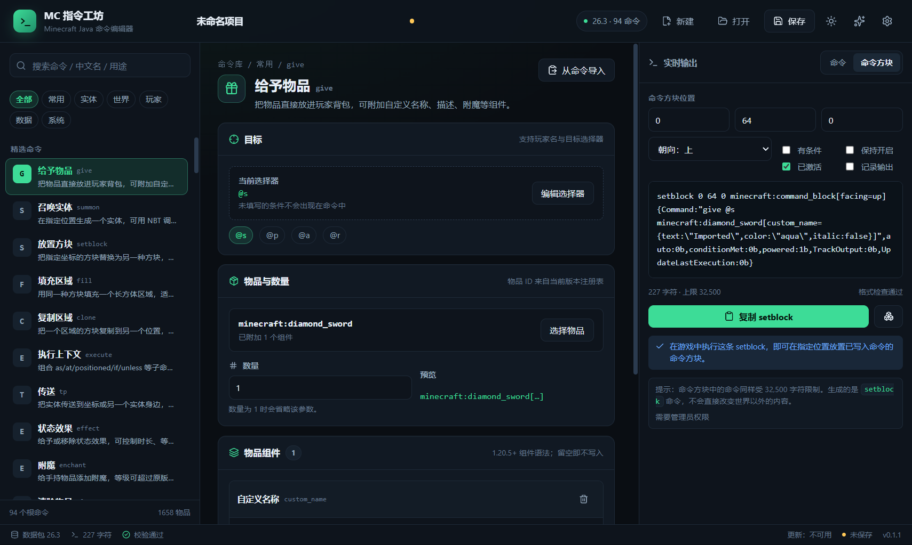

- 面包屑显示 `根命令 › 字面量 › 参数=值`，点击任意一层可回退。
- 字面量子命令按钮平铺；参数逐行显示类型、提示、输入与“添加”。
- 到达可执行节点时提示“当前节点可以执行”。
- 所有 94 个根命令都可进入；没有中文说明的命令回退显示英文 ID。
- “上一步”“重置”随时可用。

## 5. 输出与命令方块

- 右上角切换“命令 / 命令方块”。
- 命令模式：显示 `/give` 等命令本体，复制按钮为“复制命令”。
- 命令方块模式：坐标 X/Y/Z、朝向、有条件、保持开启、已激活、记录输出；输出 `/setblock`，复制按钮为“复制 setblock”。
- CodeMirror 只读展示，自动换行；长命令可滚动。
- 校验结果按 error/warn/info 着色；无错误时显示“格式检查通过”。
- 权限提示（如“需要管理员权限”）来自命令树。

## 6. 选择器弹窗

- 类型：`@s / @p / @a / @r / @n / @e`，带说明。
- 玩家名、实体类型（datalist 161 项）、标签、距离、等级、游戏模式、数量上限、排序。
- X/Y/Z 坐标与 dx/dy/dz 范围。
- NBT 复合标签文本域。
- 底部实时预览完整选择器；应用/重置/取消。

## 7. 设置

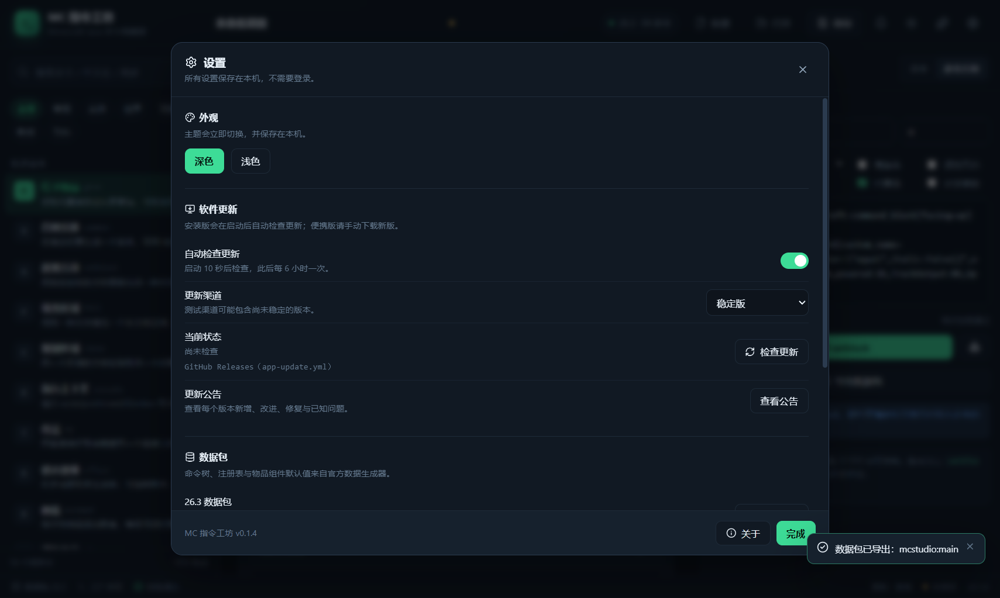

- 外观：深色/浅色立即切换。
- 软件更新：自动检查开关、稳定/测试渠道、当前状态、检查更新、重启安装。
- 数据包：版本、命令/物品/参数统计、pack_format、路径、打开目录。
- 最近项目、诊断导出、日志目录、Electron/Chromium 版本。

## 8. 更新公告

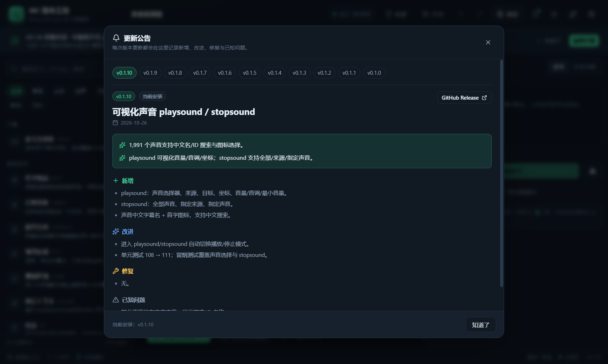

- 更新后首次启动，主界面顶部显示公告横幅：版本、标题、第一条亮点、“查看详情 / 知道了”。
- 顶栏铃铛入口，未读时显示绿色小圆点；点击打开当前版本公告。
- 主界面品牌区、欢迎页、关于页统一使用新 Logo（顶栏 36px 方形图标）。
- 弹窗只展示当前版本，不显示版本列表；只包含新增 / 改进 / 修复，不显示“已知问题”。
- 底部“查看历史版本”跳转 GitHub Releases；右上角“GitHub Release”打开对应发布页。
- 点击“知道了”会把 `lastSeenVersion` 写入本地设置，横幅与铃铛圆点消失；可在设置 → 软件更新 → 更新公告或帮助菜单再次打开。

## 9. 自动更新与自动保存

- 更新横幅：发现新版本、下载进度、下载完成、失败重试/手动下载；“稍后”可收起；“跳过此版本”持久化。
- 自动保存横幅：检测到崩溃恢复内容时提供“恢复内容 / 忽略”。
- 状态栏实时显示自动保存时间与保存状态。

## 10. 快捷键

| 快捷键 | 行为 |
|---|---|
| `Ctrl+K` | 聚焦命令搜索 |
| `Ctrl+Enter` | 复制当前输出 |
| `Ctrl+N` | 新建项目 |
| `Ctrl+O` | 打开项目 |
| `Ctrl+S` | 保存 |
| `Ctrl+Shift+S` | 另存为 |
| `Ctrl+,` | 设置 |
| `Ctrl+T` | 切换主题 |
| `Ctrl+Z` | 撤销 |
| `Ctrl+Shift+Z` / `Ctrl+Y` | 重做 |
| `Esc` | 关闭当前弹窗 |

## 11. 主题与可访问性

- CSS 变量主题，深色为默认；浅色在设置中切换并持久化。
- 字体：`Segoe UI` + `Microsoft YaHei UI`，代码使用 `Cascadia Code / Consolas`。
- 高 DPI：Electron 自动缩放；125%/150% 下布局保持三栏，最小窗口 1080×680。
- 所有按钮有可见文字或 `aria-label`；输入有 `<label>` 或 `aria-label`。
- 中文输入法：不使用全局键盘拦截 Enter（仅在输入框非组合状态下的 Enter 用于参数添加）；`Esc` 只在弹窗内处理关闭。

## 12. 空状态与错误状态
- 未选命令：欢迎页。
- 搜索无结果：提示按命令 ID 搜索。
- 数据包缺失：错误面板 + 重试 / 打开目录 / `pnpm data:build` 提示。
- 项目文件损坏：Toast 提示，不覆盖当前工作。
- 无更新 / 开发模式：设置中明确说明“安装版生效”。

## 13. 撤销与重做

- 顶栏“撤销/重做”按钮位于“打开”和“保存”之间；无历史时禁用。
- 覆盖所有表单、通用构建器、命令方块设置、项目名称；不包含主题、搜索、弹窗等 UI 状态。
- 最多 100 步；连续输入按 500ms 合并，避免每字符一步。
- 新建/打开项目清空历史；历史仅保存在当前会话，不写入 `.mcstudio`。
- 输入框/文本域内保留原生撤销；在表单外使用 `Ctrl+Z` / `Ctrl+Shift+Z` / `Ctrl+Y`。
