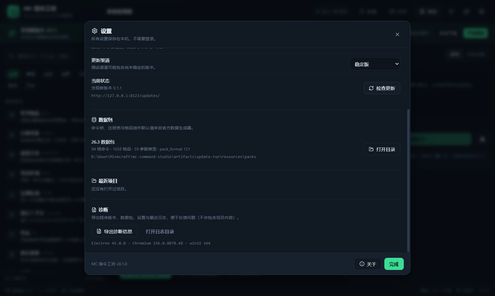

# 08 · 发布与自动更新

> 这篇文章同时是操作手册：照着做可以从 0 打包出一个能给其他人安装、并且能自动升级的 Windows 版本。

## 1. 交付物

| 产物 | 说明 |
|---|---|
| `MC-Command-Studio-Setup-<版本>.exe` | NSIS 安装包，单用户安装，无需管理员 |
| `MC-Command-Studio-<版本>-portable.exe` | 便携版，解压/双击即用；**不支持自动更新** |
| `latest.yml` | 自动更新元数据（版本、文件名、sha512、大小） |
| `*.exe.blockmap` | 增量更新块索引 |
| `checksums.txt` | SHA-256 校验和 |
| `CHANGELOG.md` | 更新说明 |

本轮实测（未签名）：

| 文件 | 大小 |
|---|---:|
| `MC-Command-Studio-Setup-0.1.3.exe` | 125,500,464 B ≈ 119.7 MiB |
| `MC-Command-Studio-0.1.3-portable.exe` | 113,252,654 B ≈ 108.0 MiB |
| `MC-Command-Studio-Setup-0.1.3.exe.blockmap` | 132,597 B |
| `latest.yml` | 363 B |

安装目录为 `%LOCALAPPDATA%\Programs\MC Command Studio`（per-user），卸载器保留用户项目与设置，可选择手动删除。

## 2. 自动更新架构

```
启动 10s ──► 检查 latest.yml ──► 有新版 ──► 横幅
  │                              │
  │                              ├─ 下载（后台，显示进度）
  │                              ├─ 下载完成 ──► 重启安装（quitAndInstall）
  │                              └─ 跳过此版本（settings.skippedVersion）
  └─ 每 6 小时重复；失败静默/降级
```

实现位置：`apps/desktop/src/main/updater.ts`，状态通过 `updater:event` 推给渲染层。



| 状态 | UI |
|---|---|
| `disabled` | 开发模式提示；不请求网络 |
| `checking` | 状态栏“检查中” |
| `available` | 横幅：版本、更新说明、下载/稍后/跳过 |
| `downloading` | 进度条与百分比 |
| `downloaded` | “重启并安装” |
| `error` | 错误原因 + 重试 + 手动下载 |
| `not-available` | 设置中“已是最新” |

关键配置：

- `autoDownload = false`：先让用户确认。
- `autoInstallOnAppQuit = true`：退出时也可安装。
- `allowDowngrade = false`。
- 稳定渠道 `latest.yml`；测试渠道 `beta.yml` + `allowPrerelease=true`。
- `MCSTUDIO_UPDATE_URL` 可将更新源覆盖为 `generic` 静态地址（本地测试/国内镜像）。

## 3. 更新源

### 3.1 默认：GitHub Releases

`apps/desktop/electron-builder.yml` 里：

```yaml
publish:
  - provider: github
    owner: JiangNanChina
    repo: mc-command-studio
    releaseType: draft
```

本仓库已完成配置，并已发布：
[MC 指令工坊 v0.1.3](https://github.com/JiangNanChina/mc-command-studio/releases/tag/v0.1.3)（最新）、
[v0.1.2](https://github.com/JiangNanChina/mc-command-studio/releases/tag/v0.1.2)、
[v0.1.1](https://github.com/JiangNanChina/mc-command-studio/releases/tag/v0.1.1) 与
[v0.1.0](https://github.com/JiangNanChina/mc-command-studio/releases/tag/v0.1.0)。

如果你 fork 到其他账号，需要把 `owner/repo` 改成你的仓库，否则 `app-update.yml` 指向不存在的仓库，检查更新会失败。可以运行：

```bash
pnpm configure:github <你的GitHub用户名> mc-command-studio
```

该命令会同步修改 `electron-builder.yml`、关于页、帮助菜单与 README 中的链接。

公开仓库是最简单的方案。私有仓库需要把 token 分发给每个用户，不建议。

### 3.2 国内镜像

准备一个静态目录，结构与 GitHub Release 相同：

```
https://your-cdn.example.com/mc-command-studio/updates/
  latest.yml
  MC-Command-Studio-Setup-0.1.1.exe
  MC-Command-Studio-Setup-0.1.1.exe.blockmap
```

构建时设置 `MCSTUDIO_UPDATE_URL`，或发布一个“国内镜像版”安装包。镜像与 GitHub 必须同步 `latest.yml`，否则会出现版本检测不一致。

### 3.3 数据包与软件更新解耦

- 软件更新：换 exe。
- 数据包更新：`packs/index.json` 独立检查，下载后无需重启（当前首版尚未做在线下载，数据包随安装包）。

## 4. CI 发布流程

`.github/workflows/release.yml` 在 push tag `v*` 时触发：

1. checkout / Node 24 / pnpm 11.28.5。
2. `pnpm install --frozen-lockfile`。
3. `pnpm setup:electron`（Electron 45 不再有 postinstall）。
4. `pnpm data:build` + `pnpm typecheck` + `pnpm test`。
5. `pnpm build:win`（electron-builder）。
6. `node tools/release/verify-version.mjs "$tag"` 校验版本、产物、`CHANGELOG.md` 与内置更新公告的当前版本。
7. 生成 `checksums.txt`。
8. 创建 **draft** Release，上传安装包、便携版、`latest.yml`、blockmap、checksums。

人工检查后发布 draft，自动更新才会对用户生效。

本地等价命令：

```bash
pnpm typecheck
pnpm test
pnpm data:build
pnpm build:win
node tools/release/verify-version.mjs v0.1.0
```

## 5. 代码签名

### 5.1 为什么必须

Windows SmartScreen 会把未签名 exe 标记为“未知发布者”，用户需要点“更多信息 → 仍要运行”。自动更新在签名校验上也更可靠。

### 5.2 配置

electron-builder 支持：

- 证书文件：CI secrets `CSC_LINK`（base64 或路径）与 `CSC_KEY_PASSWORD`。
- 或 Azure Trusted Signing（`win.azureSignOptions`，按 electron-builder 文档配置）。

CI 已经透传这两个 secrets；没有配置时构建继续，但产物未签名。

注意：

- `publisherName` 必须与证书主体一致，electron-updater 会校验更新包签名。
- 未签名 → 已签名切换时，用户需要重装一次；建议在首个公开版前完成证书准备。
- 没有证书时，发布页应提供 SHA-256 与 VirusTotal 链接，并在 FAQ 中说明 SmartScreen 提示。

## 6. 版本、渠道与回滚

- SemVer：`0.1.3`；tag `v0.1.3`。
- 软件版本与游戏版本（`26.3`）解耦；数据包版本在设置中显示。
- 渠道：stable（默认）/ beta（设置切换）。
- 不自动降级；回滚 = 发布一个更高版本的修复版，或让用户手动安装 Releases 里的旧安装包。
- 项目文件带 `schemaVersion`；新版本必须能打开旧项目，旧版本打开新项目要明确报错。
- 保留最近 3 个版本的安装包与 `latest.yml` 历史（用于手动回滚）。

## 7. 更新测试（本地）

### 7.1 准备两版安装包

```powershell
# 0.1.0
node tools/pipeline/build-pack.mjs --version 26.3
pnpm --filter @mcstudio/desktop build
pnpm --filter @mcstudio/desktop exec electron-builder --win --publish never `
  --config.directories.output=../../release/update-0.1.0

# 改成 0.1.1
pnpm release:patch
pnpm --filter @mcstudio/desktop build
pnpm --filter @mcstudio/desktop exec electron-builder --win --publish never `
  --config.directories.output=../../release/update-0.1.1
```

### 7.2 安装旧版

```powershell
Start-Process -Wait "release\update-0.1.0\MC-Command-Studio-Setup-0.1.0.exe" -ArgumentList "/S"
```

### 7.3 启动本地更新源

把 0.1.1 的 `latest.yml`、安装包、blockmap 放进 `release/update-feed/`：

```powershell
pnpm update:serve release/update-feed 8123
```

### 7.4 启动已安装的旧版并检查

安装版默认从 `%LOCALAPPDATA%\Programs\MC Command Studio\MC Command Studio.exe` 启动。测试时设置环境变量（只影响本次启动）：

```powershell
$env:MCSTUDIO_UPDATE_URL = "http://127.0.0.1:8123/updates/"
& "$env:LOCALAPPDATA\Programs\MC Command Studio\MC Command Studio.exe"
```

在设置 → 软件更新 → 检查更新，应看到 `v0.1.1`；下载后重启安装；再次启动版本应为 0.1.1，项目与设置保留。

### 7.5 验收项

- [x] 检查到新版本
- [x] 下载进度到 100%
- [x] 重启安装成功
- [x] 版本变为 0.1.1
- [x] 用户数据目录保留
- [ ] 断网或源不可达时功能不受影响（代码静默降级，未单独 e2e）
- [ ] “跳过此版本”（代码已实现，未单独 e2e）
- [x] 便携版提示手动更新（`PORTABLE_EXECUTABLE_DIR` 模式实测）

**实测结果（2026-10-26）**：
- `0.1.2 → 0.1.3`：安装 0.1.2，设置 `MCSTUDIO_UPDATE_URL=http://127.0.0.1:8123/updates/`，检查 → 下载 → 重启安装，exe 产品版本变为 **0.1.3.0**，静默完成，用户数据保留。
- `0.1.1 → 0.1.2`、`0.1.0 → 0.1.1` 同样通过。

> 已发布的 v0.1.0 使用旧 updater 代码，点击“重启并安装”会显示 NSIS 安装向导；从 v0.1.1 起改为静默安装（`quitAndInstall(true, true)`）。

GitHub Actions 的 Release 工作流已在本仓库成功执行：
- v0.1.0：run 40275025582 → [Release](https://github.com/JiangNanChina/mc-command-studio/releases/tag/v0.1.0)
- v0.1.1：run 40280079017 → [Release](https://github.com/JiangNanChina/mc-command-studio/releases/tag/v0.1.1)
- v0.1.2：run 40282580103 → [Release](https://github.com/JiangNanChina/mc-command-studio/releases/tag/v0.1.2)
- v0.1.3：run 40285593907 → [Release](https://github.com/JiangNanChina/mc-command-studio/releases/tag/v0.1.3)

公开的 `releases/latest/download/latest.yml` 返回 200，内容版本 `0.1.3`，指向 `MC-Command-Studio-Setup-0.1.3.exe`，大小 125,500,464 字节，与 Release 资产一致。

便携版模式通过 `PORTABLE_EXECUTABLE_DIR` 启动验证：自动更新被禁用，设置中显示“便携版不支持自动更新，请手动下载新版”（截图 `docs/assets/portable.png`）。


> 注意：NSIS 在自定义 `/D=` 静默安装时可能把产品目录再嵌套一层（本轮测试路径为 `artifacts/update-run/MC Command Studio/MC Command Studio.exe`）。默认安装路径不受影响；自动化测试脚本会递归查找 exe。

> 如果从设置了 `ELECTRON_RUN_AS_NODE=1` 的终端启动 Electron（部分自动化环境会设置），应用会以 Node 模式运行并立即退出。运行 `pnpm e2e` 或便携版测试前先移除该变量。

> 增量更新需要更新源里同时保留旧版本的 `.blockmap`，否则 electron-updater 会回退到全量下载（仍可成功，只是流量更大）。

## 8. 隐私

- 无账号、无遥测、无崩溃上报。
- 更新检查只发送应用版本与系统信息（HTTPS）；可在设置关闭自动检查。
- 项目内容只保存在本机；诊断导出不会包含项目内容。
- 卸载默认保留用户项目与设置，并在卸载器中说明。

## 9. 发布检查清单

见 [07-roadmap-risks.md](07-roadmap-risks.md) 第 5 节。
